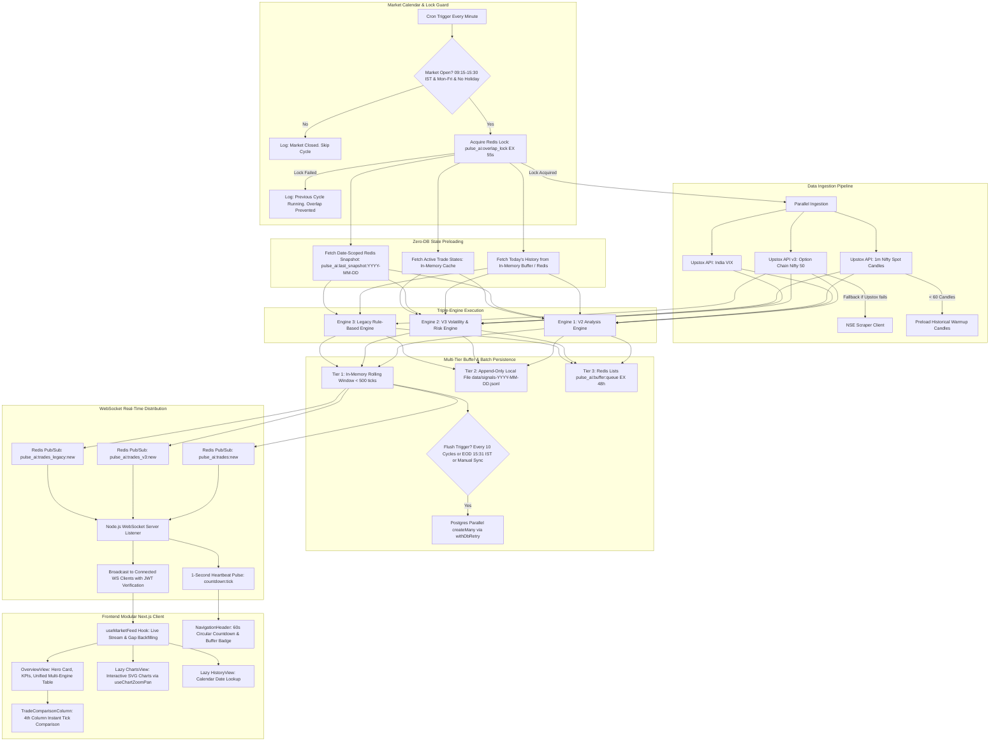
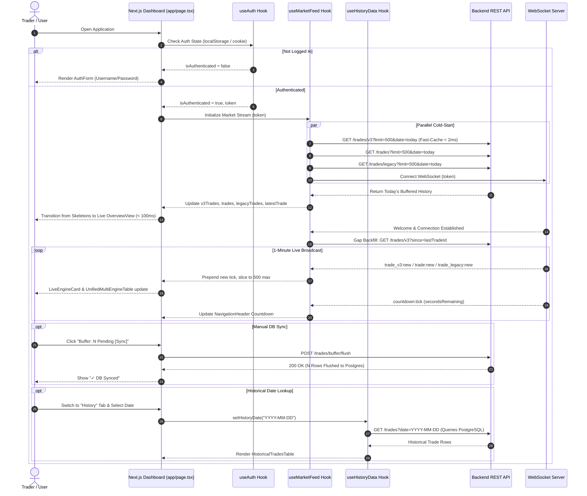

# PulseAI — End-to-End System Workflow

This document provides a comprehensive operational blueprint of the entire PulseAI platform across **Backend (`pulse_ai_backend`)** and **Frontend (`pulse_ai_frontend`)**. It details the exact sequence of events, data pipelines, state transitions, broadcasting mechanisms, buffer synchronization, and client-side ingestion paths.

---

## 1. High-Level Architecture Workflow

PulseAI operates on a **buffered global tick architecture**. Market data is fetched, calculated, and buffered server-side once every 60 seconds during active Indian market hours (9:15 AM – 3:30 PM IST), completely independent of how many users are logged in. Clients consume the live WebSocket broadcast, while database writes are decoupled via micro-batches and End-of-Day (EOD) flushes.

---

## 2. 60-Second Background Market Ingestion Cycle

Every 60 seconds, `src/cron-worker.ts` executes the following sequential steps:

### Step 1: Calendar Validation & Overlap Mutex
1. Checks whether the current time is within Indian market hours (09:15 to 15:30 IST), weekday (Mon–Fri), and not an official NSE trading holiday.
2. Acquires distributed Redis lock `pulse_ai:overlap_lock` with a 55-second TTL. If previous execution is still running, current cycle is skipped cleanly.

### Step 2: Parallel Market Data Ingestion
1. Queries Upstox API v3 for:
   - Complete NIFTY 50 Option Chain (LTP, OI, Greeks, bid/ask depth).
   - India VIX index level.
   - 1-minute historical spot candles for true OHLC indicator calculations.
2. If Upstox API fails or rate-limits, falls back to the automated NSE scraper client (`src/utils/nse-client.util.ts`).

### Step 3: Zero-DB State Preloading
1. Fetches today's trade history directly from the in-memory `TradesBufferService` (or Redis `pulse_ai:buffer:v3:YYYY-MM-DD`).
2. Zero PostgreSQL queries are issued during active minute cycles.

### Step 4: Triple-Engine Calculations
1. **Engine 1: V2 Analysis (`src/scripts/v2_analyze.ts`)**:
   - Calculates volume PCR, OI PCR, Max Pain, Support/Resistance levels.
   - Updates state machine (`active_state`) with hold cycles and cooldowns.
2. **Engine 2: V3 Volatility & Risk Engine (`src/scripts/v3_analyze.ts`)**:
   - Evaluates India VIX regime, Greeks (Delta, spreads), and depth order flow imbalance.
   - Calculates true RSI(10), ADX(14), and ATR(14) on 1-minute OHLC candles.
   - Manages dynamic ATR stop-losses, take-profits, and trailing stops.
3. **Engine 3: Legacy Rule-Based Engine (`src/scripts/legacy_analyze.ts`)**:
   - Computes classic rule-based PCR heuristics.

### Step 5: Multi-Tier Buffer Storage
Instead of issuing individual `INSERT` queries to PostgreSQL every minute, signals are written to:
- **Tier 1 (In-Memory)**: Rolling array in `TradesBufferService` (< 500 items) serving live reads in `< 1ms`.
- **Tier 2 (Append-Only Disk)**: `data/signals-YYYY-MM-DD.jsonl` ensuring zero data loss across process restarts.
- **Tier 3 (Redis Queue)**: Redis list `pulse_ai:buffer:queue` for cluster persistence.

### Step 6: Micro-Batch & EOD Database Persistence
1. Every 10 cron cycles (~10 minutes), the buffer flushes pending rows in parallel using pooler-safe `createMany`.
2. At **15:31 IST** (market close), an automated EOD cron job (`31 15 * * 1-5`) executes a final sync to PostgreSQL.
3. Process shutdown handlers (`SIGINT`, `SIGTERM`) guarantee that all buffered signals are flushed before exit.

### Step 7: Real-Time Broadcast
1. Emits Redis Pub/Sub messages (`pulse_ai:trades:new`, `pulse_ai:trades_v3:new`, `pulse_ai:trades_legacy:new`).
2. WebSocket server broadcasts events to all authenticated client connections.

---

## 3. Frontend Client Architecture & Data Flow

Built with **Next.js 16 (App Router)**, **React 19**, and **Tailwind CSS**, the client application has been optimized for speed, modularity, and zero layout shift.

### 1. State Isolation via Custom Hooks
- **`hooks/useAuth.ts`**: Handles token persistence, login, registration with 6-character validation, and session termination.
- **`hooks/useMarketFeed.ts`**: Manages the live WebSocket connection, auto-reconnection with backoff, gap backfilling, countdown ticks, and multi-engine live state arrays.
- **`hooks/useHistoryData.ts`**: Manages calendar date selection, querying historical sessions from PostgreSQL, and log deletion.
- **`hooks/useChartZoomPan.ts`**: Reusable hook handling mouse wheel zooming, mouse dragging/panning, SVG coordinate projections, zoom range slider, and fullscreen modal toggle.

### 2. Code-Splitting & Skeleton Screens
- `app/page.tsx` is an orchestrator (~180 lines). Heavy views are dynamically imported with `next/dynamic`:
  - `ChartsView`: Lazy-loaded with `<ChartSkeleton />`.
  - `HistoryView`: Lazy-loaded with `<TableSkeleton rows={10} />`.
  - `V3ExecutionFeedTable`: Lazy-loaded with `<TableSkeleton rows={8} />`.
  - `LegacyExecutionFeedTable`: Lazy-loaded with `<TableSkeleton rows={8} />`.
  - `TradeDetailsModal` and `SentimentModal`: Loaded on demand when requested.
- Guarantees **Cumulative Layout Shift (CLS = 0)** and instant initial page load.

### 3. Clean, Zero-Emoji UI Design
- All informal emojis (`⚡`, `🏛️`, `📊`, `📁`, `📦`, `🎉`) have been eliminated.
- Native, featherlight SVG icons (`components/common/Icons.tsx`) provide an institution-grade, distraction-free aesthetic.
- Color theming is centralized in `lib/trade-utils.ts` via `getSignalTheme()`:
  - Bullish: High-contrast emerald accents (`BUY CE`, `HOLD CE`).
  - Bearish: High-contrast rose accents (`BUY PE`, `HOLD PE`).
  - Exit: Purple accents (`EXIT`).
  - Neutral: Zinc tones (`HOLD`, `Sideways`).

### 4. Real-Time Buffer Status & Manual Sync
- `NavigationHeader.tsx` polls `GET /trades/buffer/status` every 20s and on every minute boundary tick.
- Displays buffer state:
  - `Buffer: N Pending [Sync]`: Indicates uncommitted memory ticks. Clicking triggers an immediate batch flush to PostgreSQL.
  - `✓ DB Synced`: Confirms all ticks are persisted to PostgreSQL.

---

## 4. Multi-Platform Distribution Workflow

The frontend code builds into three production distributions:
1. **Web (Next.js)**: Runs on browser via Turbopack build (`npm run build` -> `next start`).
2. **Desktop (Electron)**: Packaged via `main-electron.js` into cross-platform desktop installers (`npm run electron`).
3. **Mobile (Capacitor / Android)**: Configured in `capacitor.config.json` with App ID `com.pulseai.app`, builds native Android APK packages.
