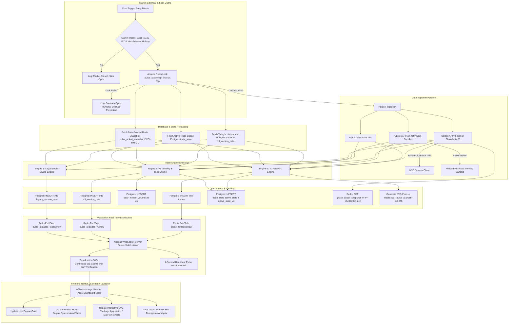
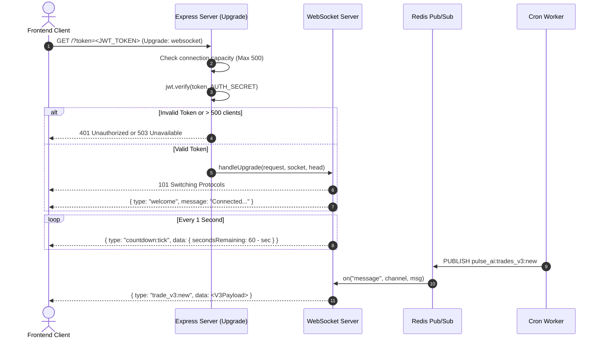
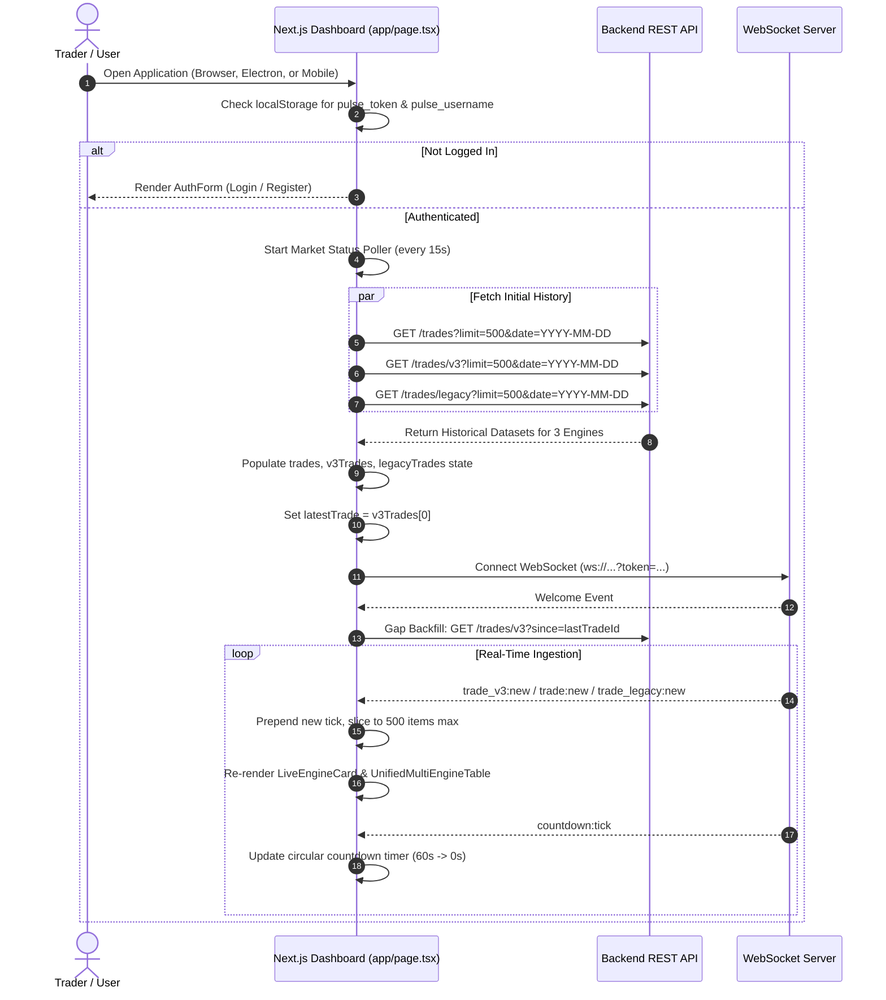

# PulseAI — End-to-End System Workflow

This document provides a comprehensive operational blueprint of the entire PulseAI platform across **Backend (`pulse_ai_backend`)** and **Frontend (`pulse_ai_frontend`)**. It details the exact sequence of events, data pipelines, state transitions, broadcasting mechanisms, and client-side ingestion paths.

---

## 1. High-Level Architecture Workflow

PulseAI operates on a **server-driven global tick architecture**. Market data is fetched, calculated, and persisted server-side once every 60 seconds during active Indian market hours (9:15 AM – 3:30 PM IST), completely independent of how many users are logged in. Clients simply connect and consume the live broadcast.

---

## 2. Detailed Cron Worker Execution Cycle (`src/cron-worker.ts`)

The background cron worker is triggered every minute (`* * * * *`). It performs the following sequential actions:

### Step 1: Market Schedule & Calendar Verification
- Uses `src/workers/market-calendar.helper.ts`.
- Computes current time in India Standard Time (`Asia/Kolkata`, UTC+5:30).
- Skips execution if:
  1. Day is Saturday (6) or Sunday (0).
  2. Date matches one of the declared `NSE_HOLIDAYS_2026` dates (e.g. Republic Day, Holi, Diwali, etc.).
  3. Time is before 09:15 IST or after 15:30 IST.

### Step 2: Distributed Overlap Lock Acquisition
- Redis key: `pulse_ai:overlap_lock`.
- Command: `redis.set("pulse_ai:overlap_lock", "locked", "EX", 55, "NX")`.
- If key exists, the previous cycle is still executing or network latency delayed API responses. The worker safely logs an overlap prevention warning and returns early.
- The `finally` block releases the lock upon completion or failure.

### Step 3: Historical Data & Previous State Retrieval
- **Today's Trades History**: Fetches up to 1,000 trades from PostgreSQL `trades` where `timestamp >= today 00:00:00 IST`. Sorts chronologically for EMA, RSI, and ADX calculations.
- **V3 Trades History**: Fetches up to 1,000 trades from PostgreSQL `v3_version_data` for V3 state tracking.
- **Option Chain Snapshot**: Reads Redis key `pulse_ai:last_snapshot:${istDateStr}`. The key is date-scoped to eliminate overnight contamination (prevents opening ticks from comparing against previous day close OI).
- **Active Trade States**: Reads PostgreSQL table `trade_state` for keys `active_state` (V2 state machine) and `active_state_v3` (V3 state machine).

### Step 4: Multi-Source Market Data Ingestion
- **Option Chain (`fetchOptionChainFromUpstox`)**:
  - Symbol: `NSE_INDEX|Nifty 50`.
  - Upstox API v3 retrieves strike-grouped contracts with:
    - Calls (`CE`): LTP, OI, Chg OI, Volume, IV, Greeks (Delta, Gamma, Theta, Vega), Bid/Ask prices & quantities.
    - Puts (`PE`): LTP, OI, Chg OI, Volume, IV, Greeks, Bid/Ask.
    - Underlying NIFTY Spot Price.
  - Retries up to 3 times with exponential backoff.
  - If Upstox API fails or tokens expire, it falls back to the scraping client `src/utils/nse-client.util.ts`.
- **India VIX (`fetchIndiaVix`)**:
  - Fetches quote for `NSE_INDEX|India VIX`. Fallback to standard 15.0 if unavailable.
- **Nifty 1-Minute Candles (`fetchNiftyCandles`)**:
  - Fetches intraday 1-minute OHLC candles for Nifty spot.
  - If candles count < 60 (early morning), it invokes `fetchHistoricalNiftyCandles` to warm up with the previous trading session's last 30 candles.

### Step 5: Triple-Engine Execution

#### Engine 1: V2 Analysis (`src/scripts/v2_analyze.ts`)
1. Computes core option metrics:
   - Volume/OI-weighted ATM Strike selection.
   - Put-Call Ratio (PCR = total PE volume / total CE volume).
   - Max Pain strike (minimizes total option buyers payout).
   - Support (Max PE OI strike) & Resistance (Max CE OI strike).
   - IV Skew (Average PE IV - CE IV near ATM).
   - ATM Straddle Cost (ATM CE LTP + ATM PE LTP).
2. Calculates technicals:
   - RSI (10-period Wilders on spot history).
   - ADX (14-period on synthetic/spot moves with DI crossover).
   - Spot Trend & EMA Trend (10-period EMA).
3. Computes F&O Buildup Score:
   - Categorizes each strike into Long Buildup, Short Buildup, Long Unwinding, Short Covering.
   - Aggregates and clips to `[-0.75, +0.75]`.
4. Executes V2 State Machine:
   - Evaluates composite conviction score `[-1.0, +1.0]`.
   - Applies hysteresis entry (`PULSE_ENTRY_SCORE = 0.60`) and exit (`PULSE_EXIT_SCORE = 0.25`).
   - Enforces `min_hold_cycles` (3 minutes) and `cooldown_cycles` (3 minutes after exit).
   - Produces signals: `BUY CE`, `BUY PE`, `HOLD CE`, `HOLD PE`, `EXIT CE (...)`, `EXIT PE (...)`.

#### Engine 2: V3 Analysis (`src/scripts/v3_analyze.ts`)
1. Option Greeks & Microstructure Imbalance:
   - Computes ATM `ceDelta` and `peDelta`.
   - Computes ATM Bid/Ask spreads (`ceSpread`, `peSpread`).
   - Computes Order Book Depth Imbalance: `(Total Bid Qty - Total Ask Qty) / (Total Bid Qty + Total Ask Qty)`.
   - Computes Directional Delta-Weighted OI Flow Imbalance across all strikes.
2. True OHLC Technicals & Volatility Regimes:
   - Calculates true 14-period ADX on actual 1m candle High/Low/Close.
   - Calculates 14-period ATR (Average True Range) on Nifty spot.
   - Tracks Opening Session Regime (9:15–9:30 IST) spot velocity ($V_t$) and retracement ($R_t$).
   - India VIX Volatility Gating: Scales thresholds dynamically based on VIX levels (< 13: Complacent, 13–18: Normal, 18–24: Elevated, > 24: High Volatility).
3. Dynamic Risk Management & State Machine:
   - Computes dynamic Stop-Loss and Take-Profit prices using ATR multiples.
   - Implements Trailing Stop mechanism when trade reaches 1.5x risk.
   - Enforces whipsaw circuit breakers (blocks repeated false exits).

#### Engine 3: Legacy Analysis (`src/scripts/legacy_analyze.ts`)
1. Classic rule-based calculations without state machines:
   - Standard PCR and strike clustering.
   - Support and resistance based on 60% OI + 40% Chg OI weight.
   - Simple sentiment score with fixed thresholds.

### Step 6: Database Persistence & Snapshot Storage
- **Postgres Inserts**:
  - `prisma.trade.create`: V2 trade record.
  - `prisma.v3VersionData.create`: V3 trade record.
  - `prisma.legacyVersionData.create`: Legacy trade record.
  - `prisma.dailyMinuteVolume.upsert`: Logs cumulative minute-level volume for R-Vol calculation.
- **Postgres State Upserts**:
  - Updates `active_state` (V2 state) and `active_state_v3` (V3 state) in `trade_state` table.
- **Redis Snapshots**:
  - Sets `pulse_ai:last_snapshot:${istDateStr}` with 24-hour TTL.
  - Generates SVG charts via `plotter.util.ts` and caches base64 in Redis (`pulse_ai:chart:trading_plot`, `aggression_plot`, `max_pain_plot`).

### Step 7: Real-Time Event Publishing
Publishes lightweight JSON payloads over Redis Pub/Sub:
- `pulse_ai:trades:new` (V2 record)
- `pulse_ai:trades_v3:new` (V3 record)
- `pulse_ai:trades_legacy:new` (Legacy record)

---

## 3. WebSocket Real-Time Distribution Workflow (`src/sockets/websocket.server.ts`)

The WebSocket server runs alongside Express on `PORT_WS` (default 3001).

1. **Authentication on Upgrade**:
   - Clients must pass `?token=<JWT>` in the connection URL.
   - Server verifies the JWT signature against `AUTH_SECRET`.
   - Max 500 concurrent connections; excess connections receive `503 Service Unavailable`.
2. **Channel Mapping**:
   - `pulse_ai:trades:new` -> emits `trade:new` to WS clients.
   - `pulse_ai:trades_v3:new` -> emits `trade_v3:new` to WS clients.
   - `pulse_ai:trades_legacy:new` -> emits `trade_legacy:new` to WS clients.
3. **Minute Boundary Countdown**:
   - A 1-second `setInterval` loop calculates `secondsRemaining = 60 - now.getSeconds()`.
   - Broadcasts `{ type: "countdown:tick", data: { secondsRemaining, timestamp } }` so the UI countdown progress bar stays perfectly synchronized across all devices.

---

## 4. REST API Request Workflows

### Authentication Flow (`/auth`)
1. **POST `/auth/register`**:
   - Body: `{ username, password, hp_website }`.
   - Validates username (must be exactly 6 characters via Zod schema).
   - Honeypot check: `hp_website` must be empty (blocks automated bot scrapers).
   - Hashes password using `bcryptjs` (salt rounds = 10).
   - Inserts into `users` table. Returns user metadata without password.
2. **POST `/auth/login`**:
   - Body: `{ username, password, hp_website }`.
   - Validates user existence and checks bcrypt hash.
   - Signs JWT containing `{ id, username }` valid for 7 days.
   - Sets `pulse_token` HttpOnly, Secure cookie and returns JSON token.
3. **POST `/auth/logout`**:
   - Clears `pulse_token` cookie.

### Multi-Engine Trades Retrieval (`/trades`)
All endpoints are protected by `authenticateToken` middleware (checks Bearer token header or `pulse_token` cookie).
1. **GET `/trades` (V2 Engine)**:
   - Query: `?date=YYYY-MM-DD&since=<ID>&limit=400`.
   - Returns array of serialized V2 records.
2. **GET `/trades/v3` (V3 Engine)**:
   - Query: `?date=YYYY-MM-DD&since=<ID>&limit=400`.
   - Returns array of serialized V3 records with Greeks, spreads, depth imbalance.
3. **GET `/trades/legacy` (Legacy Engine)**:
   - Query: `?date=YYYY-MM-DD&since=<ID>&limit=400`.
   - Returns array of serialized Legacy records.
4. **GET `/trades/compare`**:
   - Returns unified list matching timestamps across all 3 engines.
5. **GET `/trades/compare/details?timestamp=...`**:
   - Fetches the closest matching record from V2, V3, and Legacy within ±60 seconds.
6. **GET `/trades/latest`**:
   - Fetches the single latest record from `trades` (V2).
7. **DELETE `/trades/:id`**:
   - Deletes trade record by ID.

### Charts Retrieval (`/charts/:name`)
- Endpoint: `GET /charts/trading_plot`, `aggression_plot`, `max_pain_plot`.
- Query: `?disable_spot=true&disable_pcr=true`.
- If cached in Redis and query parameters are standard, serves cached PNG image buffer directly.
- On cache miss or dynamic query flags, calls `ChartsService.renderAndCacheCharts` which runs `src/utils/plotter.util.ts` in-memory to generate standalone SVGs converted to PNG buffers.

### Upstox OAuth Integration (`/auth/upstox`)
1. **GET `/auth/upstox/login`**:
   - Redirects the administrator to Upstox's official authorization dialog with `UPSTOX_CLIENT_ID` and redirect URI.
2. **GET `/auth/upstox/callback?code=...`**:
   - Exchanges auth code for API access token.
   - Stores the active token in `UpstoxAuthService` for subsequent option chain calls.

---

## 5. Frontend Client Lifecycle (`pulse_ai_frontend`)

Built on **Next.js 16 (App Router)** and **React 19**, the frontend manages data flow through `app/page.tsx`.

### 1. Boot & Authentication State
- Reads `localStorage.getItem("pulse_token")` and `pulse_username`.
- If present, sets `isAuthenticated = true` and `token`.
- If missing, displays `components/AuthForm.tsx`. Supports switching between Login and Register with instant error validation.

### 2. Market Status Loop
- Function `checkMarketStatus` calculates IST time from UTC every 15 seconds.
- Updates `marketOpen` boolean state (displayed on `NavigationHeader.tsx` with live indicator).

### 3. Initial Multi-Engine History Fetch
- On authenticated mount, fires parallel `Promise.all` calls:
  - `api.trades.getV2All({ limit: 500, date: todayStr })`
  - `api.trades.getV3All({ limit: 500, date: todayStr })`
  - `api.trades.getLegacyAll({ limit: 500, date: todayStr })`
- Sets `latestTrade` to the top record of `v3Trades`.

### 4. WebSocket Subscription & Gap Backfilling
- Connects to `process.env.NEXT_PUBLIC_WS_URL` with query parameter `?token=...`.
- Tracks `lastTradeIdRef`. On connection or reconnection:
  - Backfills missed trades via `api.trades.getV3All({ since: lastTradeIdRef.current })`.
  - Merges, de-duplicates by ID, and prepends to state.
- In case of disconnect, triggers an automatic reconnect attempt after a 5-second backoff timer.

### 5. UI Component Hierarchy & Synchronization
- **`NavigationHeader.tsx`**: Top navigation bar showing brand logo, live market status (Open/Closed), 60s countdown timer, engine selector, and user logout.
- **`LiveEngineCard.tsx`**: Hero component displaying the latest actionable signal (`BUY CE`, `BUY PE`, `EXIT`, `HOLD`), conviction color cues, and summary breakdown.
- **`KPIStatsCards.tsx`**: Displays instant snapshot metrics: Spot Price, PCR, Max Pain, Support, Resistance, IV Skew, RSI, ADX, Straddle Cost.
- **`UnifiedMultiEngineTable.tsx`**: Aggregates ticks from V3, V2, and Legacy by rounding timestamps to minute boundaries (`YYYY-MM-DDTHH:mm:00`), displaying synchronized rows across all 3 engines.
- **`TradeComparisonColumn.tsx`**: The 4th column in the table layout. Clicking any row pins that minute tick and compares V3, V2, and Legacy side-by-side with divergence alerts.
- **`InteractiveTradingChart.tsx`**: Native SVG charting component with spot price line, PCR overlay, buy/sell marker badges, zoom/pan sliders, and fullscreen toggle.
- **`HistoricalTradesTable.tsx`**: Historical tab allowing the user to select any previous date via date picker and inspect the full session execution log.

---

## 6. Multi-Platform Distribution Workflow

The frontend is structured to deploy to three distinct form factors from a single codebase:
1. **Web (Next.js)**: Runs on browser via standard Next.js build (`npm run dev` or `npm run build`).
2. **Desktop (Electron)**: Driven by `main-electron.js`, packages the Next.js bundle into a native cross-platform desktop window (`npm run electron`).
3. **Mobile (Capacitor / Android)**: Configured in `capacitor.config.json` with App ID `com.pulseai.app`, builds native WebView packaging for Android APK/AAB distribution.
